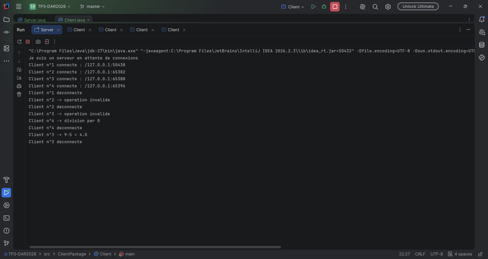
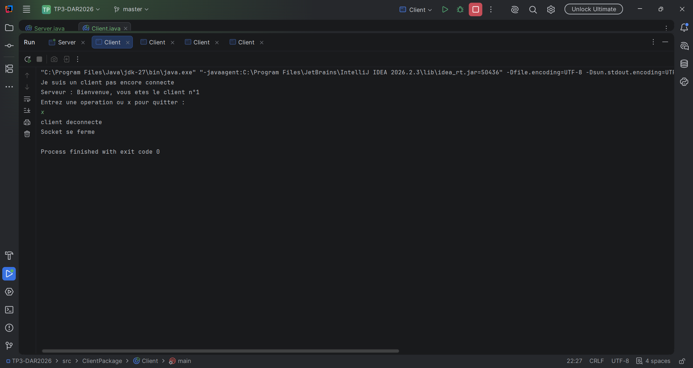
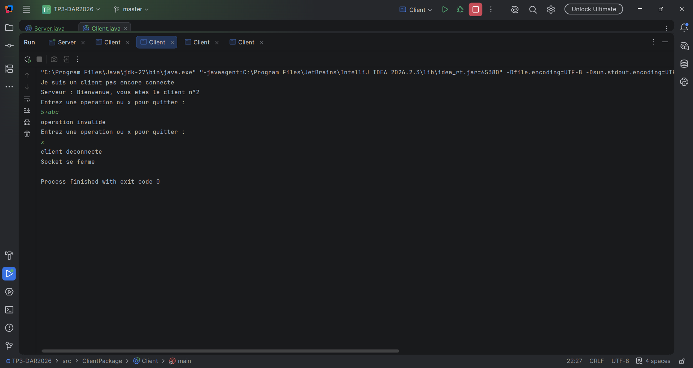
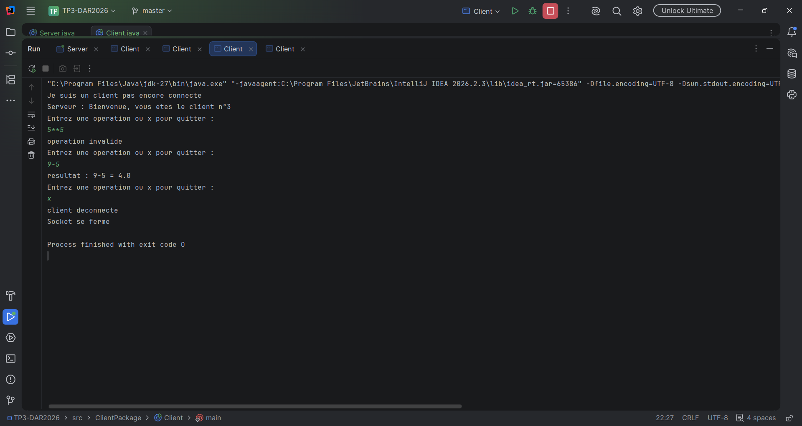
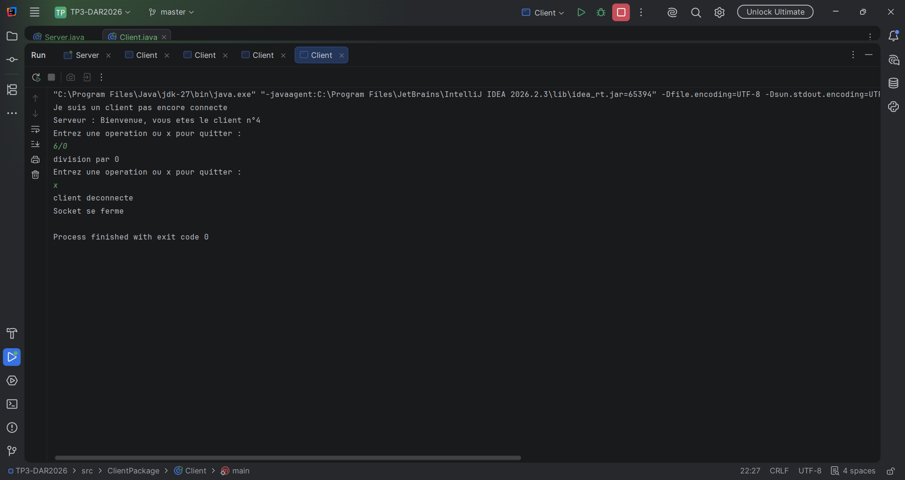

# TP3-DAR2026 : Serveur multi-threads (sockets TCP)

## Tests réalisés

### Serveur
Le serveur affiche l'adresse IP et le numéro d'ordre de chaque client connecté.

### Client n°1

### Client n°2

### Client n°3

### Client n°4

## Synthèse

**Objectif.** Cette activité fait évoluer l'application client/serveur de TP2 pour que le serveur traite plusieurs clients en même temps avec les sockets TCP en Java.

**Solution : un thread par client.**
- Le thread principal du serveur boucle sur `accept()`.
- À chaque connexion, il attribue un numéro d'ordre (`AtomicInteger`) et crée un thread `ClientHandler` dédié.
- Les clients sont ainsi servis en parallèle sans se bloquer entre eux.

**Informations côté serveur.** Pour chaque client, le serveur affiche son adresse IP et son port (`getRemoteSocketAddress()`) et son numéro d'ordre, et envoie ce numéro au client.

**Gestion des erreurs.** Les cas « syntaxe invalide », « operation invalide » et « division par 0 » sont signalés des deux côtés.

**Résultats.** Les 4 clients se sont connectés simultanément au même serveur. Chacun a reçu un numéro différent et a obtenu ses résultats sans être bloqué par les autres.

**Conclusion.** Le modèle « un thread par client » est simple et efficace pour un petit nombre de clients. Pour un grand nombre de connexions, un pool de threads (`ExecutorService`) serait plus adapté.