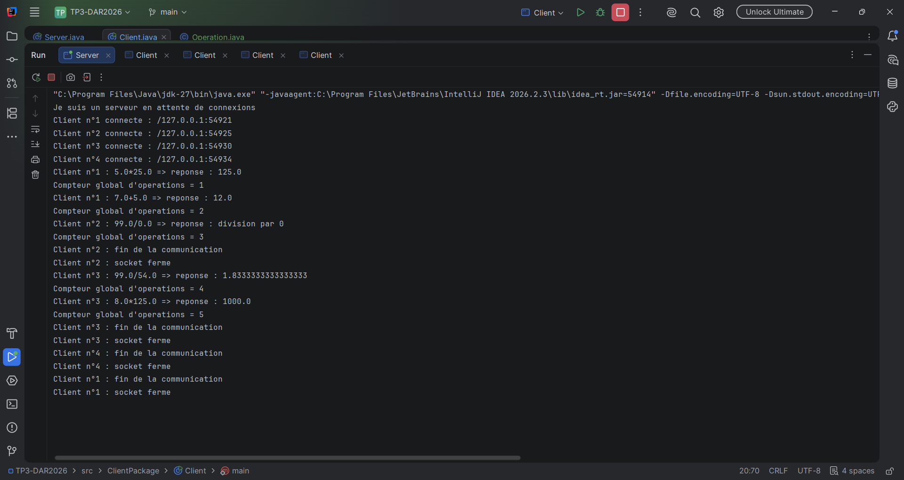
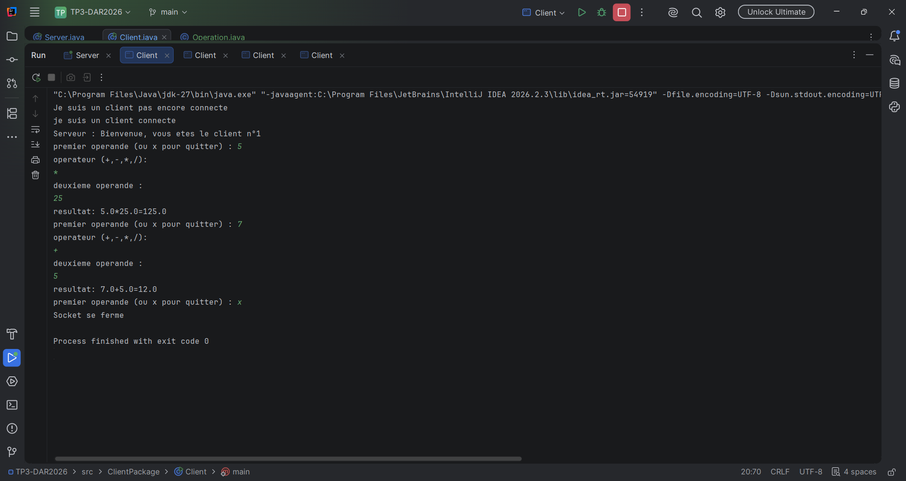
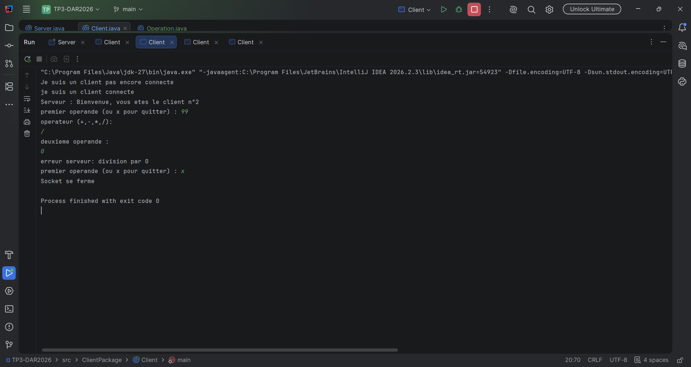
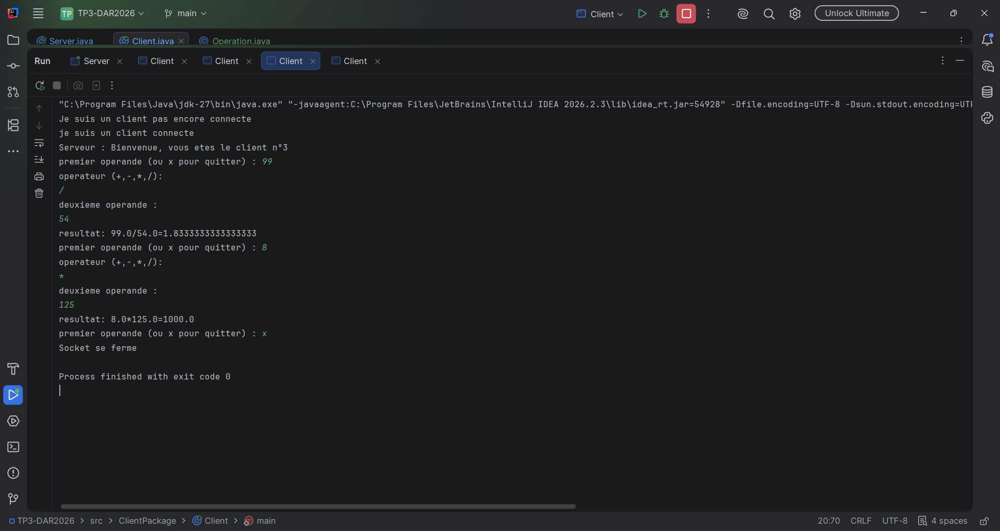
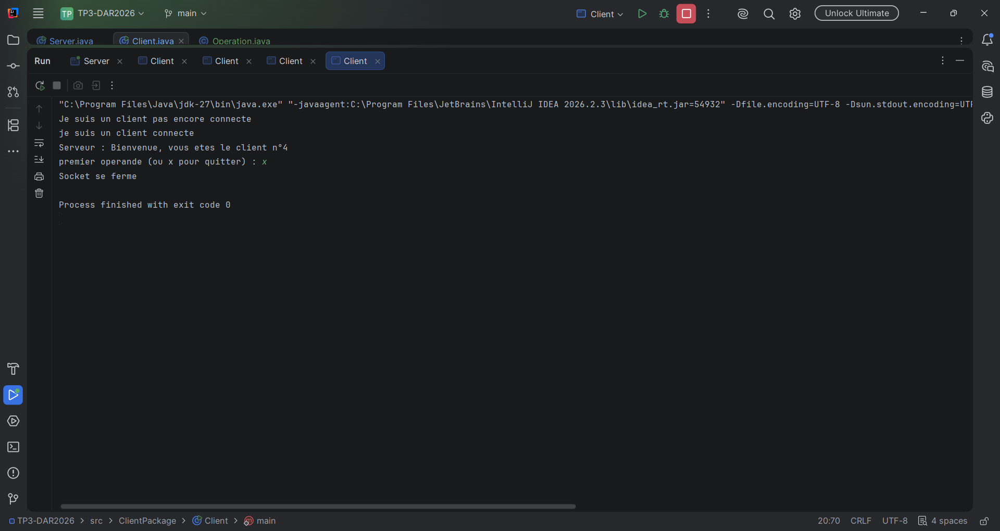

# TP3-DAR2026 : Serveur multi-threads (sockets TCP)

## Tests réalisés

### Serveur
Le serveur affiche l'adresse IP et le numéro d'ordre de chaque client connecté, chaque opération traitée et la valeur du compteur global.

### Client n°1

### Client n°2

### Client n°3

### Client n°4

## Synthèse

**Objectif.** Intégrer le service de calculatrice par objets (TP2, activité 2-2) dans le serveur multi-thread de l'activité 3-1, afin de traiter en parallèle les opérations de plusieurs clients.

**Serveur multi-thread.** Le serveur boucle sur `accept()` et lance un thread `ClientProcess` pour chaque client, après lui avoir attribué un numéro d'ordre et affiché son adresse IP. Chaque client a ses propres flux, donc un client inactif ne bloque pas les autres.

**Communication par objets.** Le client envoie un objet `Operation` (`Serializable`) et le serveur renvoie le résultat ou un message d'erreur (`division par 0`, `operateur invalide`).

**Accès concurrent.** Le compteur global d'opérations est partagé entre tous les threads. Comme `compteur++` n'est pas atomique, deux threads pourraient perdre un incrément. La méthode qui incrémente et affiche le compteur est donc `synchronized`.

**Résultats.** Les 4 clients se sont connectés en même temps, ont reçu des numéros différents, et le compteur global a progressé de 1 en 1 jusqu'au nombre total d'opérations envoyées. Le test en réseau local, avec l'IP du serveur dans le client, a donné le même résultat.

**Conclusion.** Le modèle « un thread par client » permet un vrai traitement simultané, et la synchronisation garantit un compteur cohérent.